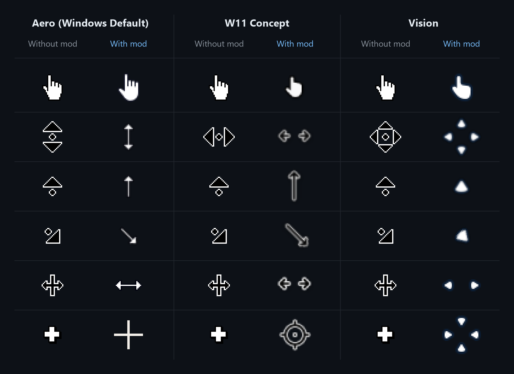

# Cursor Scheme Extension

**English** · [Русский](README.ru.md) · [DSN Windhawk Mods](../README.md)

Cursor Scheme Extension replaces built-in application pointers with pointers from the selected Windows scheme. This includes middle-button autoscroll, the pointing hand, resizing, and text and table selection.

The mod uses the scheme already selected in Windows and picks up changes to it automatically. Transformed pointers are created and cached in memory.



Cursor artwork: Windows and Office by Microsoft, [W11 Concept](https://www.deviantart.com/jepricreations/art/Windows-11-Cursors-Concept-HD-v2-890672103) by jepriCreations, [Vision](https://www.deviantart.com/idarques/art/Vision-Cursor-911891424) by IDarques.

## Features

| Setting | Controls |
| --- | --- |
| Hand | Pointing hand over buttons, links, and other interactive elements |
| Resize | Resizing panels, rows, columns, and objects |
| Move | Dragging cells, ranges, and objects |
| Autoscroll activation | The pointer after a wheel-click, before choosing a scroll direction |
| Autoscroll arrows | All eight scrolling directions |
| Selection arrows | Selecting rows, columns, or an entire table |
| Cell selection | The cross over cells and when selecting ranges |
| Margin selection | Selecting text from the left page margin |
| Vertical text input | The horizontal mouse pointer in areas with vertical text |

At the start of autoscroll, the pointer indicates vertical, horizontal, or both axes. Direction arrows use **Alternate select** (`Up`) from the Windows scheme, rotated to match the scrolling direction. Selection arrows use the same role. Transforms account for the pointer hotspot, and animated pointers retain their frame order and timing.

The interface is available in English, Russian, Spanish, German, Brazilian Portuguese, and Simplified Chinese.

### Limitations

- Replacement applies to recognized pointers displayed through Windows cursor APIs. The application controls whether autoscroll is available, its speed, and its direction.
- Excel and Firefox draw their stationary autoscroll markers separately. These markers keep their original appearance.
- Monochrome pointers that invert the background retain their original pixel rendering without smoothing.
- The cache holds up to 128 replacement instances, including those still in use from stopped sessions. When full, further requests use the original pointer.
- Disabling the mod restores application pointers. Unresponsive UI threads finish restoring when they resume. Cursor handles and callback code can remain allocated until the owning thread exits. If Windows cannot identify input owners or destroy a helper window, affected resources remain until the process exits.

## Platforms

Requires Windows 11 and [Windhawk](https://windhawk.net/). Runtime checks cover x86 and x64 processes on Windows 11 x64 with Windhawk 1.7.3. ARM64 has been compiled without a runtime check. Microsoft 365 and Qt WebEngine have not been verified.

## Operations

### Installation

1. Open Windhawk and choose **Create a New Mod**.
2. Replace the contents of `mod.wh.cpp` with the complete [mod source](Mod/cursor-scheme-extension.wh.cpp).
3. Select **Compile Mod**, exit the editor, and check that **Cursor Scheme Extension** is enabled on the Windhawk home page.

To update a local installation, open its editor, replace the source, and compile it again.

[Windhawk editing mode guide](https://github.com/ramensoftware/windhawk/wiki/Editing-mode-guidelines)

### Usage

Select a pointer scheme in Windows, then open the mod's **Settings** in Windhawk. **Applications and processes** selects the application families, and **Pointer types** selects the shapes to replace. Both must be enabled for a replacement to apply.

| Family | Coverage |
| --- | --- |
| Windows | Native Windows pointers, standard controls, and Windows Forms |
| Office | Desktop Word, Excel, PowerPoint, and classic Outlook |
| Chromium | Chrome, Edge, Electron, and compatible embedded browsers |
| Gecko | Firefox and compatible apps: cell selection, resizing, and vertical text |
| Qt | Panel splitters in applications with a Qt interface |

Under **Application exclusions**, below the family switches, add one executable name or full path per row. A name matches any installation of that executable; a full path matches one location.

**Smoothing** has separate switches for **Autoscroll activation**, **Autoscroll arrows**, and **Selection arrows**. Autoscroll smoothing covers all eight directions.

### Verification

Run the lifecycle tests from this mod directory on Windows with PowerShell and the compiler bundled with Windhawk 1.7.3.

```powershell
pwsh -NoProfile -File .\Tests\Run-LifecycleTests.ps1
```

The tests cover reentrant callbacks, shared input queues, handle reuse, and restoration on x86 and x64. They use isolated processes and preserve the installed settings.

The [Win32 preview source](Tests/cursor-scheme-extension-preview.cpp) displays all eleven system autoscroll states. Build it as `cursor-scheme-extension-preview.exe` and open it with the mod enabled. Wheel-click **Vertical**, **Horizontal**, or **Both axes**, then move away from the starting point and back. Try the four diagonals in **Both axes**. Press **F2** for the Windows Reader Mode path.

## Links

- [Change mouse settings in Windows](https://support.microsoft.com/en-us/windows/hardware/input-devices/change-mouse-settings)
