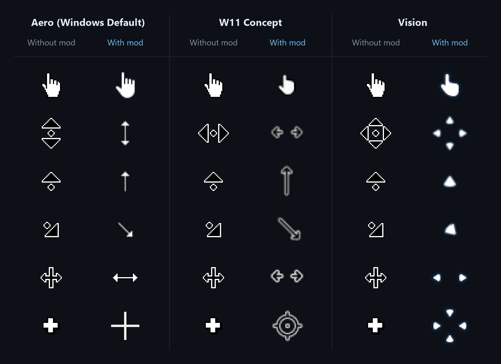

# Cursor Scheme Extension

[English](README.md) · **Русский** · [DSN Windhawk Mods](../README.ru.md)

Cursor Scheme Extension заменяет встроенные курсоры приложений курсорами из выбранной схемы Windows. Это касается автопрокрутки колесиком, руки над кнопками, изменения размеров, выделения текста и ячеек.

Мод использует уже выбранную в Windows схему и автоматически подхватывает ее изменения. Преобразованные указатели создаются и кешируются в памяти.

## Функции



Авторы курсоров: Windows и Office — Microsoft, [W11 Concept](https://www.deviantart.com/jepricreations/art/Windows-11-Cursors-Concept-HD-v2-890672103) — jepriCreations, [Vision](https://www.deviantart.com/idarques/art/Vision-Cursor-911891424) — IDarques.

| Настройка | Что меняет |
| --- | --- |
| Рука | Указательный палец над кнопками, ссылками и другими активными элементами |
| Изменение размеров | Изменение размеров панелей, строк, столбцов и объектов |
| Перемещение | Перетаскивание ячеек, диапазонов и объектов |
| Включение автопрокрутки | Указатель после нажатия на колесико, до выбора направления прокрутки |
| Стрелки автопрокрутки | Все восемь направлений прокрутки |
| Стрелки выделения | Выделение строк, столбцов или всей таблицы |
| Выбор ячейки | Крестик над ячейками и при выделении диапазонов |
| Выделение снаружи | Выделение текста с левого поля страницы |
| Вертикальный ввод | Горизонтальный курсор мыши в областях с вертикальным текстом |

При включении автопрокрутки указатель показывает доступные оси: вертикаль, горизонталь или обе. Для направлений прокрутки и стрелок выделения используется роль **Специальное выделение** (`Up`) из схемы Windows, повернутая в нужную сторону. Поворот учитывает точку щелчка, а анимированные курсоры сохраняют порядок кадров и интервалы.

Интерфейс доступен на английском, русском, испанском, немецком, бразильском португальском и упрощенном китайском.

### Ограничения

- Подменяются распознанные указатели, которые приложение выводит средствами Windows. Доступность, скорость и направление автопрокрутки определяет само приложение.
- Excel и Firefox отдельно рисуют неподвижные значки автопрокрутки. Эти значки сохраняют исходный вид.
- Монохромные курсоры с инверсией фона сохраняют исходную пиксельную отрисовку без сглаживания.
- При каждой загрузке мод создает не более 128 подмен в одном процессе. При возврате к прежней схеме или настройке сглаживания подходящие экземпляры используются повторно. При заполнении запросы, требующие нового экземпляра, используют исходный курсор приложения.
- После отключения приложение восстанавливает свой курсор при следующем обновлении указателя, обычно при движении мыши. Дескрипторы подмен сохраняются до завершения процесса, чтобы еще используемые Windows курсоры оставались допустимыми.

## Платформы

Нужны Windows 11 и [Windhawk](https://windhawk.net/). Выполнение x86 и x64 проверено на Windows 11 x64 с Windhawk 1.7.3. Для ARM64 проверена компиляция без запуска. Microsoft 365 и Qt WebEngine не проверены.

### Совместимость

Часть функций мода может пересекаться с возможностями следующих модов:

- [Chromium Cursor Remap](https://windhawk.net/mods/chromium-cursor-remap) — подмена дополнительных курсоров Chromium и Electron.
- [Cursor Override](https://windhawk.net/mods/cursor-override) — подмена дополнительных курсоров файлами `.cur` и `.ani`.

Не следует одновременно подменять одинаковые курсоры несколькими модами в одном приложении: итоговый вид курсора может зависеть от порядка применения подмен.

## Эксплуатация

### Установка

1. В Windhawk выбрать «Создать новую модификацию».
2. Заменить содержимое `mod.wh.cpp` полным [исходником мода](Mod/cursor-scheme-extension.wh.cpp).
3. Скомпилировать мод, выйти из редактора и убедиться, что **Cursor Scheme Extension** включен на главной странице Windhawk.

Для обновления локальной установки открыть ее редактор, заменить исходник и повторить компиляцию.

При обновлении с 1.0.2 или более ранней версии перед компиляцией запустить [Migrate-Settings.ps1](Tools/Migrate-Settings.ps1) с новым путем `-BackupPath`, чтобы сохранить настройку **Стрелки выделения**. Порядок запуска приведен в [описании инструментов](Tools/TOOLS.md).

[Режим редактирования Windhawk](https://github.com/ramensoftware/windhawk/wiki/Editing-mode-guidelines)

### Использование

Выбрать схему курсоров в Windows, затем открыть вкладку **Настройки** мода в Windhawk. В блоке **Приложения и процессы** выбираются группы приложений, в блоке **Виды курсоров** — формы для подмены. Подмена действует, когда включены и группа, и вид курсора.

| Группа | Где действует |
| --- | --- |
| Windows | Системные указатели, стандартные элементы интерфейса и Windows Forms |
| Office | Настольные Word, Excel, PowerPoint и классический Outlook |
| Chromium | Chrome, Edge, Electron и совместимые встроенные браузеры |
| Gecko | Firefox и совместимые приложения: выбор ячеек, изменение размеров и вертикальный текст |
| Qt | Разделители панелей в приложениях с интерфейсом на Qt |

В поле **Исключение приложений** под переключателями групп указывается имя файла запуска или полный путь, по одному на строку. Имя действует для всех установок программы, полный путь — для одного расположения.

В блоке **Сглаживание** отдельно настраиваются **Включение автопрокрутки**, **Стрелки автопрокрутки** и **Стрелки выделения**. Для автопрокрутки охвачены все восемь направлений.

### Проверка

Тесты жизненного цикла запускаются из папки мода на Windows. Нужны PowerShell и компилятор из Windhawk 1.7.3.

```powershell
pwsh -NoProfile -File .\Tests\Run-LifecycleTests.ps1
```

Тесты проверяют вложенные вызовы, общие очереди ввода, повторное использование дескрипторов и безопасную выгрузку на x86 и x64. Отдельная проба трижды загружает и выгружает настоящую DLL при живом потоке интерфейса, проверяя сохранность курсора. Пробы работают в отдельных процессах и сохраняют настройки установленного мода.

Дополнительно проверяются повторное использование подмен, ограничение чтений схемы, обновления без уведомлений, аргументы Chromium и переименованная настройка выделения. `Tests/Test-SettingsMigration.ps1` проверяет перенос настроек во временных ключах реестра.

При наличии Node.js и установленного расширения Windhawk команда `node Tests/Test-Settings.cjs` проверяет метаданные, структуру настроек и переводы на всех шести языках штатным парсером Windhawk.

[Исходник окна проверки Win32](Tests/cursor-scheme-extension-preview.cpp) показывает все 11 системных состояний автопрокрутки. Собрать его под именем `cursor-scheme-extension-preview.exe` и открыть при включенном моде. Нажать колесико в области **Vertical**, **Horizontal** или **Both axes**, отвести мышь от точки нажатия и вернуть ее. В **Both axes** также проверить четыре диагонали. Клавиша **F2** переключает окно на штатный режим чтения Windows.

## Ссылки

- [Изменение параметров мыши в Windows](https://support.microsoft.com/ru-ru/windows/hardware/input-devices/change-mouse-settings)
