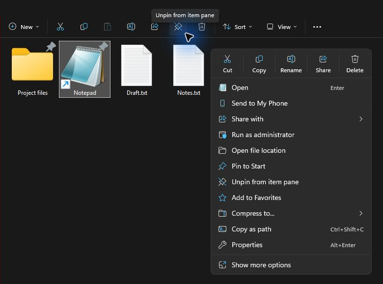
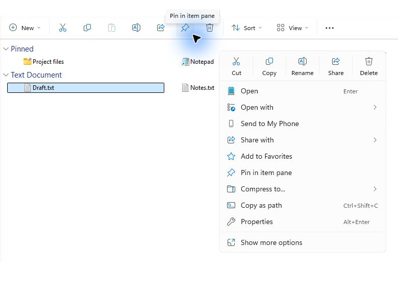

# Explorer Item Pins

**English** · [Русский](https://github.com/CTravkin/DSN_Windhawk_Mods/blob/main/Explorer_Item_Pins/README.ru.md)

Explorer Item Pins keeps selected files and folders at the top of their parent folder in Windows File Explorer. Each folder has its own pins.

## Features

|  |  |
| :---: | :---: |

- **Two ways to pin.** Use the modern context menu or the pin button between **Share** and **Delete** on the command bar.
- **Sort and group.** Pins stay at the top in either sort direction. With grouping on, they appear in the first group, **Pinned**. Explorer's sorting still applies within the group.
- **Pin indicator.** A pushpin appears at the upper-right corner of the file or folder icon. It follows the icon size and works with thumbnails, lists, details, tiles and content view.
- **Interface languages.** English, Russian, Spanish, German, Brazilian Portuguese, and Simplified Chinese.

## Platforms

The mod requires [Windhawk](https://windhawk.net/) and Windows 11 x64 with the tabbed File Explorer. Tested on Windows 11 26H2 (build `26300.9974`) with Windhawk 1.7.3. Compatibility with other Explorer builds depends on available symbols and compatible internal interfaces.

## Data exchange

Each Windows account uses a separate `pins-<SID>.json` file in the mod's Windhawk storage directory. Removing the mod removes its storage. Replacing a file under the same name keeps its pin. A rename within the same folder can keep the pin when the mod can identify the original file by its file ID. Copying or moving an item to another folder does not carry its pin with it.

## Operations

### Installation

Install Explorer Item Pins from the Windhawk catalog. To build a local copy from source, follow these steps.

1. Open Windhawk and choose **Create a New Mod**.
2. Replace the contents of `mod.wh.cpp` with the complete [mod source](https://github.com/CTravkin/DSN_Windhawk_Mods/blob/main/Explorer_Item_Pins/Mod/explorer-item-pins.wh.cpp).
3. Use **Compile Mod** or `Ctrl+B` with the Windhawk sidebar open. Exit the editor and check that **Explorer Item Pins** is enabled on the Windhawk home page.

To update an existing local installation, edit that mod in Windhawk, replace its source and compile it again.

[Windhawk editing mode guide](https://github.com/ramensoftware/windhawk/wiki/Editing-mode-guidelines)

### Usage

1. Select a file or folder and choose **Pin in item pane** in its context menu, or click the pin on the command bar.
2. To remove the pin, select the item and choose **Unpin from item pane** or click the crossed-out pin on the command bar. The item returns to its usual position in the folder.

In Windhawk, open the mod's **Settings** to control these options independently. All three are enabled by default.

If the pin commands are missing from a File Explorer window that was already open when the mod was enabled or updated, reopen that window.

| Setting | Controls |
| --- | --- |
| Context menu command | Pin and unpin in the context menu |
| Command bar button | Pin and unpin on the File Explorer command bar |
| Pinned item indicator | The pushpin on pinned file and folder icons |

### Verification

Run the tests from this mod directory on Windows with PowerShell and the compiler bundled with Windhawk 1.7.3.

```powershell
pwsh -NoProfile -File .\Tests\Test-PinStore.ps1
pwsh -NoProfile -File .\Tests\Test-ExplorerCommands.ps1
```

The tests cover storage, concurrent access, pin operations, sorting, grouping, and indicator rendering in a native Explorer view hosted in the test process.
