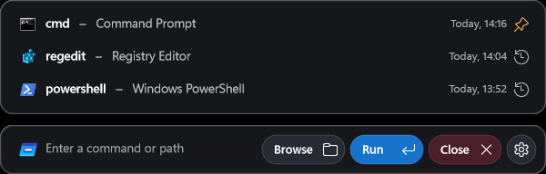
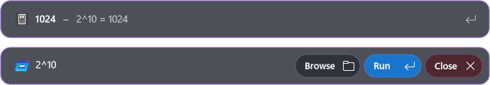
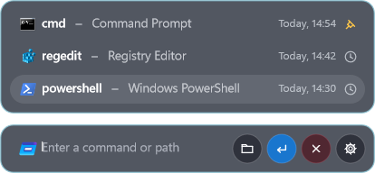
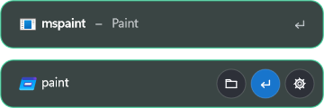
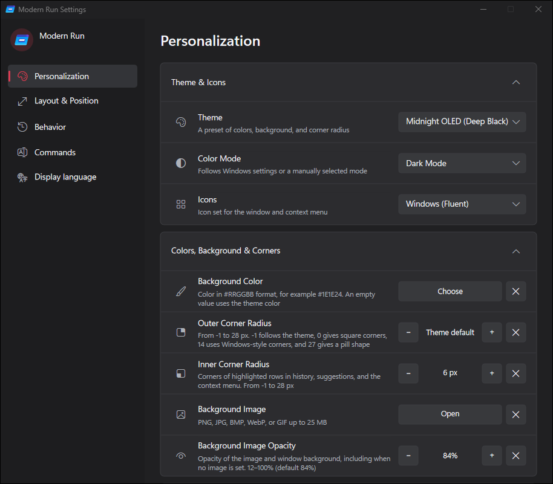

# Modern Run Dialog UI

**English** · [Tiếng Việt](README.vi.md) · [Русский](README.ru.md) · [DSN Windhawk Mods](../README.md)

Modern Run Dialog UI replaces the Windows **Run** dialog (**Win + R**) and **Run new task** in Task Manager with a customizable launcher for apps, files, and commands.

## Layouts

<table>
  <tbody>
    <tr>
      <th scope="row" valign="middle">Classic</th>
      <td align="center" valign="middle"><a href="Assets/Previews/classic-history.png"></a><br>Windows 11 Blur · Pinned command</td>
      <td align="center" valign="middle"><a href="Assets/Previews/classic-idle.png"></a><br>Warm Paper<br><br><a href="Assets/Previews/classic-suggestions.png"></a><br>Dracula Velvet · Calculator</td>
    </tr>
    <tr>
      <th scope="row" valign="middle">Compact Mini-Pill</th>
      <td align="center" valign="middle"><a href="Assets/Previews/pill-history.png"></a><br>Nord Frost · Pinned command</td>
      <td align="center" valign="middle"><a href="Assets/Previews/pill-idle.png"></a><br>Classic Win11<br><br><a href="Assets/Previews/pill-suggestions.png"></a><br>Emerald Slate · Paint suggestion</td>
    </tr>
    <tr>
      <th scope="row" valign="middle">Fluent</th>
      <td align="center" valign="middle"><a href="Assets/Previews/fluent-history.png"></a><br>Catppuccin Mocha · Pinned command</td>
      <td align="center" valign="middle"><a href="Assets/Previews/fluent-idle.png"></a><br>Windows 11 Mica<br><br><a href="Assets/Previews/fluent-elevation.png"></a><br>Fluent Solid · Administrator indicator</td>
    </tr>
  </tbody>
</table>

## Features

- **Custom commands and suggestions.** Search for apps and Windows tools by typing their names. Add short names for your own commands, programs, and files. A custom command can request administrator privileges.
- **Command history.** Keep up to 50 recent commands, pin entries, and remove them individually. Browse history and suggestions with **↑** and **↓**. Press **Tab** to fill the input or **Enter** to run the selected command.
- **Calculator and web search.** Enter an expression such as `sqrt(144)` or `2^10` and select the result to insert it and copy it to the clipboard. Type `google:<query>` to search in your default browser.
- **Run as administrator.** By default, **Ctrl + Shift + Enter** switches privileges for the current launch. If elevation is enabled by default, the same shortcut runs with standard privileges. The mod also honors the elevation option in Task Manager.

## Settings



Open Modern Run Settings with **Ctrl + ,**. Shared options are also available in Windhawk. In-app settings apply to the current user. Changing an option in Windhawk replaces the in-app choice for that option.

### Personalization

- Choose a built-in theme, follow the Windows color mode or pick light or dark, and select the default icons or **Windows (Fluent)**.
- Adjust the background color, opacity, and corner radii for panels and highlighted rows. Use a PNG, JPEG, BMP, WebP, or animated GIF as the background (up to 25 MB).
- Set the border color. Window borders can use the theme, follow Windows, or be turned off. The standard context menu also has its own border setting and can inherit the window border.

### Layout and position

- Choose a layout, set the window position, and optionally remember it. Width can follow the layout or use **Narrow**, **Wide**, or a custom value. Adjust the window height, font size, and interface scale separately.
- Hide **Browse**, **Run**, **Close**, or **Settings** in any layout. Hidden actions move to the right-click menu, which has **Standard** and **Windows (Fluent)** styles.

### Behavior

- Set the number of stored and visible history entries, hide history, or show timestamps in the Windows regional format.
- Clear the input when Run opens or close Run by clicking outside it. The taskbar icon can minimize and restore the window, close it, or be hidden.
- Enable elevation by default and choose a separate indicator panel or a shield in the input row. **Shift + Enter** normally runs the command in a terminal and can be assigned to switch privileges.

### Display language

Follow the Windows display language or choose Arabic, Chinese (Simplified or Traditional), Dutch, English, French, German, Hindi, Indonesian, Italian, Japanese, Korean, Malay, Polish, Portuguese (Brazil), Russian, Spanish, Thai, Turkish, Ukrainian, or Vietnamese.

## Platforms

Requires Windows 10 or 11 and [Windhawk](https://windhawk.net/). Smart App Control can block the unsigned DLL that Windhawk compiles locally.

## Operations

### Installation

#### Windhawk catalog (recommended)

In Windhawk, open **Explore**, search for **Modern Run Dialog UI**, and select **Install**. [Mod page in the Windhawk catalog](https://windhawk.net/mods/modern-run-dialog-ui)

#### From source (manual)

1. Open [the standalone mod source](Mod/modern-run-dialog-ui.wh.cpp).
2. Open the mod in Windhawk editing mode if it is already installed. For a fresh installation, choose **Create a New Mod**.
3. Replace the editor contents with the complete source, select **Compile Mod**, and check that the mod is enabled.

### Usage

Use **Ctrl + O** to browse for a file, **Esc** to close Run, or right-click to open the context menu. Open **Commands** in Modern Run Settings to add, edit, or remove a custom command.

### Verification

Run the layout, settings, and localization checks from the repository root with Node.js.

```powershell
node --test Modern_Run_Dialog_UI/Tests/dialog-layout.test.mjs
```
