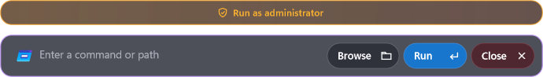

# Modern Run Dialog UI

**English** · [Tiếng Việt](README.vi.md) · [Русский](README.ru.md) · [DSN Windhawk Mods](../README.md)

Modern Run Dialog UI replaces the Windows **Run** dialog (**Win + R**) and **Run new task** in Task Manager with a customizable launcher for apps, files, and commands.

## Layouts and themes

<table>
  <tbody>
    <tr>
      <td valign="middle"><strong>Classic</strong></td>
      <td align="center" valign="middle"><a href="Assets/Previews/classic-history.png"></a><br>Windows 11 Blur</td>
      <td align="center" valign="middle"><a href="Assets/Previews/classic-idle.png"></a><br>Warm Paper<br><br><a href="Assets/Previews/classic-elevation.png"></a><br>Dracula Velvet</td>
    </tr>
    <tr>
      <td valign="middle"><strong>Compact Mini-Pill</strong></td>
      <td align="center" valign="middle"><a href="Assets/Previews/pill-history.png"></a><br>Fluent Solid</td>
      <td align="center" valign="middle"><a href="Assets/Previews/pill-idle.png"></a><br>Liquid Glass<br><br><a href="Assets/Previews/pill-minimal.png"></a><br>Emerald Slate</td>
    </tr>
    <tr>
      <td valign="middle"><strong>Fluent</strong></td>
      <td align="center" valign="middle"><a href="Assets/Previews/fluent-history.png"></a><br>Catppuccin Mocha</td>
      <td align="center" valign="middle"><a href="Assets/Previews/fluent-idle.png"></a><br>Windows 11 Mica<br><br><a href="Assets/Previews/fluent-elevation.png"></a><br>Nord Frost</td>
    </tr>
  </tbody>
</table>

## Features

- **Custom commands and suggestions.** Search for apps and Windows tools by typing their names. Add short names for your own commands, programs, and files. A custom command can request administrator privileges.
- **Command history.** Keep up to 50 recent commands, pin entries, and remove them individually.
- **Calculator and web search.** Enter an expression such as `sqrt(144)` or `2^10` and select the result to insert it and copy it to the clipboard. Type `google:<query>` to search in your default browser.
- **Run as administrator.** Launch a single command with administrator privileges or set elevation as the default. The mod honors the elevation option in Task Manager.

## Settings


Shared options are available in both Modern Run Settings and Windhawk. In-app settings apply to the current user. Changing an option in Windhawk replaces the in-app choice for that option.

### Personalization

- Choose a built-in theme, follow the Windows color mode or pick light or dark, and select the default icons or **Windows (Fluent)**.
- Adjust the background color, opacity, and corner radii for panels and highlighted rows. Use a PNG, JPEG, BMP, WebP, or animated GIF as the background (up to 25 MB).
- Set the border color. Window borders can use the theme, follow Windows, or be turned off. The standard context menu also has its own border setting and can inherit the window border.

### Layout and position

- Choose a layout, set the window position, and optionally remember it. Width can follow the layout or use **Narrow**, **Wide**, or a custom value. Adjust the window height, font size, and interface scale separately.
- Hide **Browse**, **Run**, **Close**, or **Settings** in any layout. Hidden actions move to the right-click menu, which has **Standard** and **Windows (Fluent)** styles.

### Behavior

- Set the number of stored and visible history entries, hide history, or show timestamps in the Windows regional format.
- Clear the input when Run opens or close Run by clicking outside it. The taskbar icon can minimize and restore the window, close it, or be hidden.
- Enable elevation by default and choose a separate indicator panel or a shield in the input row. Enable **Ctrl + Enter** as an additional shortcut to switch privileges.

### Display language

Follow the Windows display language or choose Arabic, Chinese (Simplified or Traditional), Dutch, English, French, German, Hindi, Indonesian, Italian, Japanese, Korean, Malay, Polish, Portuguese (Brazil), Russian, Spanish, Thai, Turkish, Ukrainian, or Vietnamese.

## Platforms

Requires Windows 10 or 11 and [Windhawk](https://windhawk.net/). Smart App Control can block the unsigned DLL that Windhawk compiles locally.

## Operations

### Installation

#### Windhawk catalog (recommended)

In Windhawk, open **Explore**, search for **Modern Run Dialog UI**, and select **Install**. [Mod page in the Windhawk catalog](https://windhawk.net/mods/modern-run-dialog-ui)

#### From source (manual)

1. Open [the mod source](Mod/modern-run-dialog-ui.wh.cpp).
2. Open the mod in Windhawk editing mode if it is already installed. For a fresh installation, choose **Create a New Mod**.
3. Replace the editor contents with the complete source, select **Compile Mod**, and check that the mod is enabled.

### Usage

Press **Win + R** to open Modern Run in place of the classic Run dialog. Type a command, an app name, or a path to a file or folder. As you type, the dialog suggests matching apps, Windows tools, and custom commands.

- **↑ / ↓** browse history and suggestions. With an empty field, press **↑** to open the history if it is enabled.
- **Tab** puts the selected item in the input so it can be edited. **Enter** runs the selected item or the text in the field.
- **Ctrl + Shift + Enter** switches privileges for this launch.
- **Shift + Enter** runs the command in a terminal.
- **Ctrl + O** opens the file picker, **Ctrl + ,** opens Modern Run Settings, and **Esc** closes the dialog.
- **Delete** removes the selected history entry. Right-click an entry to pin or remove it.

Use **Commands** in Modern Run Settings to add, edit, or remove custom commands.

### Verification

Run the layout, settings, and localization checks from the repository root with Node.js.

```powershell
node --test Modern_Run_Dialog_UI/Tests/dialog-layout.test.mjs
```
