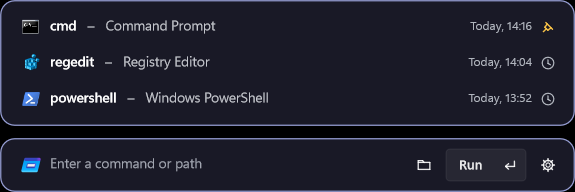

# Modern Run Dialog UI

**English** · [Tiếng Việt](README.vi.md) · [Русский](README.ru.md) · [DSN Windhawk Mods](../README.md)

Modern Run Dialog UI is a Windhawk mod by caotu2005 for Windows 10 and 11. It replaces the classic **Run** dialog opened with **Win + R** and **Run new task** in Task Manager with a customizable launcher for apps, files, and commands.

## Features

### Three layouts

Choose **Classic**, **Compact Mini-Pill**, or **Fluent**. Classic is the default. Compact Mini-Pill uses icon buttons and starts with history collapsed. Use **↑** to open it. Fluent places actions beside the input and opens history and suggestions above it. The layout, theme, action buttons, and history can be configured independently.

| Layout | History open | History closed | Calculator, suggestions, or elevation |
| --- | --- | --- | --- |
| **Classic** | [](Assets/Previews/classic-history.png)<br>Windows 11 Blur | [](Assets/Previews/classic-idle.png)<br>Warm Paper | [](Assets/Previews/classic-suggestions.png)<br>Dracula Velvet |
| **Compact Mini-Pill** | [](Assets/Previews/pill-history.png)<br>Nord Frost | [](Assets/Previews/pill-idle.png)<br>Classic Win11 | [](Assets/Previews/pill-suggestions.png)<br>Emerald Slate |
| **Fluent** | [](Assets/Previews/fluent-history.png)<br>Catppuccin Mocha | [](Assets/Previews/fluent-idle.png)<br>Windows 11 Mica | [](Assets/Previews/fluent-elevation.png)<br>Fluent Solid |

### Settings


Open the dedicated settings window from Run with **Ctrl + ,**. Use **Commands** to edit your custom commands. Shared options are also available on the mod's **Settings** tab in Windhawk. In-app changes are saved per user and apply to Run. The Windhawk tab displays its own values. Changing a shared option in Windhawk replaces the in-app override for that option.

### Appearance

- Pick a theme such as **Windows 11 Blur**, **Liquid Glass**, **Nord Frost**, or **Warm Paper**, and follow Windows colors or choose a light or dark mode.
- Customize background color, opacity, outer and inner corner radii, and borders. Set a static PNG, JPEG, BMP, or WebP background or an animated GIF up to 25 MB.
- Set the window position, width, height, font size, and scale. Position can be remembered across launches.
- Hide **Browse**, **Run**, **Close**, and **Settings** independently in every layout. Hidden actions remain available in the right-click menu. The menu style and icon set can be selected separately.
- Choose whether the taskbar icon minimizes and restores Run, closes it, or stays hidden.

### Commands and history

- Search for apps and Windows tools as you type. Add a custom command with a short name and a program, command line, or file to open. A custom command can request administrator privileges.
- Keep up to 50 recent commands. Pin entries, remove them individually, and show dates and times in the Windows regional format. Set the history length to zero to hide it.
- Use **↑** and **↓** to browse history and suggestions. Press **Tab** to put the selection in the input field, or **Enter** to run it.
- Use **Ctrl + O** to browse for a file and **Esc** to close Run.
- Enter an expression such as `sqrt(144)` or `2^10` to calculate a result. Select the result to insert it and copy it to the clipboard. Use `google:<query>` to search the web in the default browser.

### Administrator launch

Hold **Ctrl + Shift** to preview the privilege level and press **Enter** to switch it for the current launch. With elevation enabled by default, the same shortcut launches with standard privileges. Choose a separate status panel or an inline shield icon. **Shift + Enter** runs in a terminal by default and can be reassigned to switch privileges. When Task Manager starts an elevated task, its elevation request is honored.

## Platforms

Requires Windows 10 or Windows 11 and [Windhawk](https://windhawk.net/). Run uses Direct2D and DirectWrite, supports inline input through Windows IMEs, including Vietnamese keyboards, and provides 21 interface languages. The mod can be blocked by Windows Smart App Control because Windhawk compiles it locally into an unsigned DLL. The mod needs no shell32 PDB symbols.

## Operations

### Installation

#### Windhawk catalog (recommended)

In Windhawk, open **Explore**, search for **Modern Run Dialog UI**, and select **Install**. [Mod page in the Windhawk catalog](https://windhawk.net/mods/modern-run-dialog-ui)

#### From source (manual)

1. Open [the standalone mod source](Mod/modern-run-dialog-ui.wh.cpp).
2. Open the mod in Windhawk editing mode if it is already installed. For a fresh installation, choose **Create a New Mod**.
3. Replace the editor contents with the complete source, select **Compile Mod**, and check that the mod is enabled.

### Usage

Press **Win + R** or choose **Run new task** in Task Manager. In Run, right-click to access menu actions. Use **Ctrl + ,** to open the mod settings.

### Verification

Run the layout, settings, and localization checks from the repository root with Node.js.

```powershell
node --test Modern_Run_Dialog_UI/Tests/dialog-layout.test.mjs
```

## License

Modern Run Dialog UI is distributed under the [MIT license](LICENSE).
