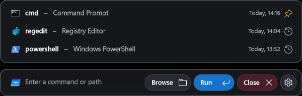
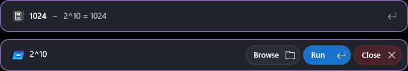
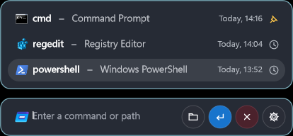
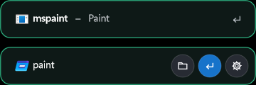
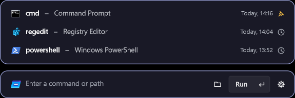
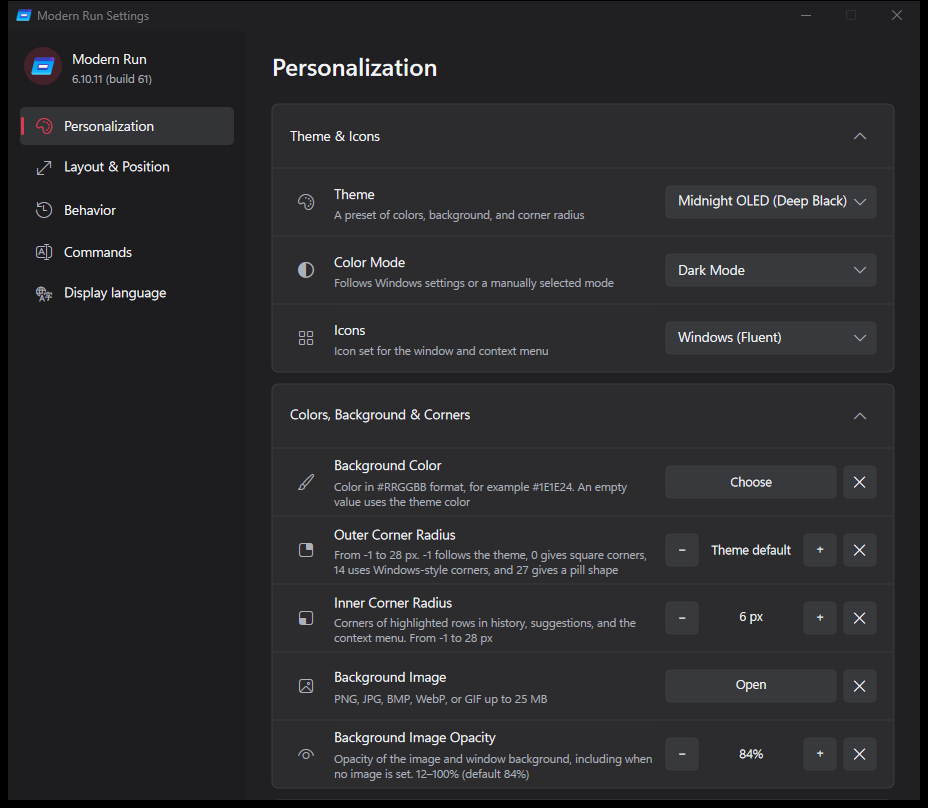

# Modern Run Dialog UI

[English](README.md) · [Tiếng Việt](README.vi.md) · **Русский** · [DSN Windhawk Mods](../README.ru.md)

Modern Run Dialog UI — мод caotu2005 для Windhawk на Windows 10 и 11. Он заменяет классическое окно **Выполнить**, которое открывается по **Win + R**, и окно **Запуск новой задачи** в Диспетчере задач. В новом окне можно запускать приложения, открывать файлы и выполнять команды.

## Функции

### Три макета

Доступны макеты **Классический**, **Компактный (Pill)** и **Fluent**. По умолчанию используется классический. В компактном макете вместо подписей на кнопках используются значки, а история при открытии свернута. Чтобы открыть историю, нажмите **↑**. Во Fluent кнопки стоят справа от поля ввода, а история и подсказки открываются над ним. Макет, тема, кнопки и история настраиваются независимо.

| Макет | История открыта | История закрыта | Калькулятор, подсказки или повышение прав |
| --- | --- | --- | --- |
| **Классический** | [](Assets/Previews/classic-history.png)<br>Windows 11 Blur | [](Assets/Previews/classic-idle.png)<br>Warm Paper | [](Assets/Previews/classic-suggestions.png)<br>Dracula Velvet |
| **Компактный (Pill)** | [](Assets/Previews/pill-history.png)<br>Nord Frost | [](Assets/Previews/pill-idle.png)<br>Classic Win11 | [](Assets/Previews/pill-suggestions.png)<br>Emerald Slate |
| **Fluent** | [](Assets/Previews/fluent-history.png)<br>Catppuccin Mocha | [](Assets/Previews/fluent-idle.png)<br>Windows 11 Mica | [](Assets/Previews/fluent-elevation.png)<br>Fluent Solid |

### Настройки



Чтобы открыть отдельное окно настроек из окна «Выполнить», нажмите **Ctrl + ,**. Собственные команды редактируются в разделе **Команды**. Общие параметры доступны и на вкладке **Настройки** мода в Windhawk. Изменения в окне мода сохраняются для текущего пользователя и применяются к окну «Выполнить». Вкладка Windhawk показывает свои значения. Изменение общего параметра в Windhawk заменяет значение, заданное для него в окне мода.

### Оформление

- Выберите тему, например **Windows 11 Blur**, **Liquid Glass**, **Nord Frost** или **Warm Paper**. Цветовой режим можно задать вручную или взять из настроек Windows.
- Можно настроить цвет и непрозрачность фона, внешние и внутренние углы и рамки. В качестве фона поддерживаются PNG, JPEG, BMP, WebP и анимированные GIF размером до 25 МБ.
- Можно задать положение, ширину и высоту окна, размер шрифта и масштаб интерфейса. Положение может сохраняться между открытиями.
- В любом макете можно скрыть по отдельности кнопки **Обзор**, **Выполнить**, **Закрыть** и **Настройки**. Скрытые действия доступны в контекстном меню. Стиль меню и набор значков выбираются отдельно.
- Значок на панели задач может сворачивать и восстанавливать окно «Выполнить» или закрывать его. Значок также можно скрыть.

### Команды и история

- По мере ввода появляются подсказки приложений и инструментов Windows. Для собственной команды можно указать короткое имя и программу, командную строку или файл. Для отдельной команды можно задать запуск от имени администратора.
- В истории сохраняется до 50 недавних команд. Записи можно закреплять и удалять по одной. Дата и время берутся из региональных форматов Windows. При длине истории 0 список скрыт.
- Клавиши **↑** и **↓** переключают записи в истории и подсказках. **Tab** вставляет выбранную запись в поле, **Enter** запускает ее.
- **Ctrl + O** открывает выбор файла, **Esc** закрывает окно «Выполнить».
- Для вычисления введите выражение, например `sqrt(144)` или `2^10`. При выборе результат вставляется в поле и копируется в буфер обмена. Запрос `google:<запрос>` открывает поиск в браузере по умолчанию.

### Запуск от имени администратора

Удерживайте **Ctrl + Shift**, чтобы увидеть, с какими правами запустится команда, и нажмите **Enter**, чтобы запустить ее с этими правами. При повышении прав по умолчанию та же комбинация запускает команду с обычными правами. Состояние показывает отдельная панель или значок щита рядом с полем. **Shift + Enter** по умолчанию запускает команду в терминале. Эту комбинацию можно назначить на смену прав. Если запуск от имени администратора выбран в Диспетчере задач, мод учитывает этот выбор.

## Платформы

Требуются Windows 10 или Windows 11 и [Windhawk](https://windhawk.net/). Окно использует Direct2D и DirectWrite, поддерживает ввод через IME Windows, в том числе на вьетнамском, и доступно на 21 языке. Интеллектуальное управление приложениями (Smart App Control) в Windows может заблокировать мод, поскольку Windhawk локально компилирует его в DLL без цифровой подписи. Мод работает без PDB-символов shell32.

## Эксплуатация

### Установка

#### Из каталога Windhawk (рекомендуется)

Откройте **Обзор** в Windhawk, найдите **Modern Run Dialog UI** и нажмите **Установить**. [Страница мода в каталоге Windhawk](https://windhawk.net/mods/modern-run-dialog-ui)

#### Из исходника (вручную)

1. Откройте [самодостаточный исходник мода](Mod/modern-run-dialog-ui.wh.cpp).
2. Откройте установленный мод в режиме редактирования Windhawk. Если мод еще не установлен, выберите **Создать новый мод**.
3. Замените содержимое редактора полным исходником, скомпилируйте мод и убедитесь, что он включен.

### Использование

Нажмите **Win + R** или выберите **Запуск новой задачи** в Диспетчере задач. Правый клик в окне «Выполнить» открывает контекстное меню. **Ctrl + ,** открывает настройки мода.

### Проверка

Из корня репозитория запустите проверки макетов, настроек и локализации с помощью Node.js.

```powershell
node --test Modern_Run_Dialog_UI/Tests/dialog-layout.test.mjs
```

## Лицензия

Modern Run Dialog UI распространяется под [лицензией MIT](LICENSE).
