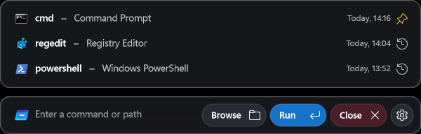
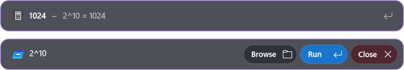
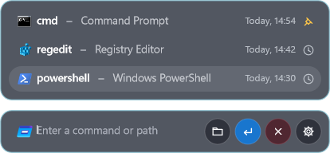
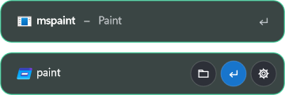
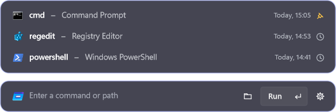

# Modern Run Dialog UI

[English](README.md) · **Tiếng Việt** · [Русский](README.ru.md) · [DSN Windhawk Mods (English)](../README.md)

Modern Run Dialog UI thay hộp thoại **Chạy** (**Win + R**) và hộp thoại **Chạy tác vụ mới** trong Trình quản lý Tác vụ bằng cửa sổ có thể tùy chỉnh để mở ứng dụng, tệp và chạy lệnh.

## Bố cục

<table>
  <tbody>
    <tr>
      <th scope="row" valign="middle">Classic</th>
      <td align="center" valign="middle"><a href="Assets/Previews/classic-history.png"></a><br>Windows 11 Blur · Lệnh đã ghim</td>
      <td align="center" valign="middle"><a href="Assets/Previews/classic-idle.png"></a><br>Warm Paper<br><br><a href="Assets/Previews/classic-suggestions.png"></a><br>Dracula Velvet · Máy tính</td>
    </tr>
    <tr>
      <th scope="row" valign="middle">Compact Mini-Pill</th>
      <td align="center" valign="middle"><a href="Assets/Previews/pill-history.png"></a><br>Nord Frost · Lệnh đã ghim</td>
      <td align="center" valign="middle"><a href="Assets/Previews/pill-idle.png"></a><br>Classic Win11<br><br><a href="Assets/Previews/pill-suggestions.png"></a><br>Emerald Slate · Gợi ý Paint</td>
    </tr>
    <tr>
      <th scope="row" valign="middle">Fluent</th>
      <td align="center" valign="middle"><a href="Assets/Previews/fluent-history.png"></a><br>Catppuccin Mocha · Lệnh đã ghim</td>
      <td align="center" valign="middle"><a href="Assets/Previews/fluent-idle.png"></a><br>Windows 11 Mica<br><br><a href="Assets/Previews/fluent-elevation.png"></a><br>Fluent Solid · Chỉ báo quyền quản trị</td>
    </tr>
  </tbody>
</table>

## Tính năng

- **Lệnh tùy chỉnh và gợi ý.** Nhập tên để tìm ứng dụng và công cụ Windows. Có thể đặt tên ngắn cho lệnh, chương trình và tệp, cũng như yêu cầu quyền quản trị cho từng lệnh.
- **Lịch sử lệnh.** Lưu tối đa 50 lệnh gần đây. Có thể ghim hoặc xóa từng mục. Dùng **↑** và **↓** để duyệt lịch sử và gợi ý, nhấn **Tab** để đưa mục đã chọn vào ô nhập hoặc **Enter** để chạy.
- **Máy tính và tìm kiếm trên web.** Nhập biểu thức như `sqrt(144)` hoặc `2^10`, rồi chọn kết quả để chèn vào ô nhập và sao chép vào bảng tạm. Dùng `google:<truy vấn>` để tìm trên trình duyệt mặc định.
- **Chạy với quyền quản trị.** Mặc định, **Ctrl + Shift + Enter** đổi quyền cho lần chạy hiện tại. Nếu đã bật quyền quản trị mặc định, tổ hợp này sẽ chạy lệnh với quyền thông thường. Mod cũng giữ tùy chọn quyền đã chọn trong Trình quản lý Tác vụ.

## Cài đặt


Nhấn **Ctrl + ,** để mở cài đặt Modern Run. Các tùy chọn chung cũng có trong Windhawk. Cài đặt trong mod áp dụng cho người dùng hiện tại. Khi sửa một tùy chọn trong Windhawk, giá trị mới sẽ thay giá trị đã đặt trong mod cho tùy chọn đó.

### Cá nhân hóa

- Chọn chủ đề có sẵn và bộ biểu tượng **Mặc định** hoặc **Windows (Fluent)**. Chế độ màu có thể theo Windows hoặc đặt riêng thành sáng hay tối.
- Tùy chỉnh màu nền, độ mờ đục và độ bo góc của các bảng và hàng được tô sáng. Có thể dùng ảnh PNG, JPEG, BMP, WebP hoặc GIF động tối đa 25 MB làm nền.
- Có thể đặt màu viền cửa sổ, dùng viền mặc định, dùng viền theo Windows hoặc tắt viền. Menu chuột phải kiểu thường có tùy chọn viền riêng và có thể dùng chung viền với cửa sổ.

### Bố cục và vị trí

- Chọn bố cục và vị trí cửa sổ, đồng thời có thể ghi nhớ vị trí. Chiều rộng có các lựa chọn **Mặc định**, **Hẹp**, **Rộng** hoặc giá trị tùy chỉnh. Chiều cao, cỡ chữ và tỷ lệ giao diện có thể chỉnh riêng.
- Ẩn riêng từng nút **Duyệt**, **Chạy**, **Đóng** hoặc **Cài đặt** trong mọi bố cục. Các thao tác đã ẩn sẽ xuất hiện trong menu chuột phải. Menu có kiểu thường và **Windows (Fluent)**.

### Hành vi

- Đặt số lệnh được lưu và số hàng hiển thị, ẩn lịch sử hoặc hiện ngày giờ theo định dạng khu vực của Windows.
- Có thể xóa nội dung ô nhập khi mở và đóng cửa sổ khi nhấp ra ngoài. Biểu tượng trên thanh tác vụ có thể thu nhỏ và khôi phục cửa sổ, đóng cửa sổ hoặc được ẩn.
- Có thể mặc định chạy với quyền quản trị và hiện trạng thái trong bảng riêng hoặc qua biểu tượng khiên cạnh ô nhập. **Shift + Enter** mặc định chạy lệnh trong thiết bị đầu cuối và có thể được gán lại để đổi quyền.

### Ngôn ngữ hiển thị

Dùng ngôn ngữ hiển thị của Windows hoặc chọn tiếng Anh, tiếng Ả Rập, tiếng Ba Lan, tiếng Bồ Đào Nha (Brazil), tiếng Đức, tiếng Hà Lan, tiếng Hàn, tiếng Hindi, tiếng Indonesia, tiếng Ý, tiếng Mã Lai, tiếng Nga, tiếng Nhật, tiếng Pháp, tiếng Tây Ban Nha, tiếng Thái, tiếng Thổ Nhĩ Kỳ, tiếng Trung (giản thể hoặc phồn thể), tiếng Ukraina hoặc tiếng Việt.

## Nền tảng

Cần Windows 10 hoặc 11 và [Windhawk](https://windhawk.net/). Kiểm soát Ứng dụng Thông minh (Smart App Control) có thể chặn tệp DLL không có chữ ký số do Windhawk biên dịch trên máy.

## Sử dụng và kiểm tra

### Cài đặt

#### Từ danh mục Windhawk (khuyên dùng)

Trong Windhawk, mở **Explore**, tìm **Modern Run Dialog UI** và chọn **Install**. [Trang mod trong danh mục Windhawk](https://windhawk.net/mods/modern-run-dialog-ui)

#### Từ mã nguồn (thủ công)

1. Mở [mã nguồn độc lập của mod](Mod/modern-run-dialog-ui.wh.cpp).
2. Nếu mod đã được cài, mở mod ở chế độ chỉnh sửa trong Windhawk. Nếu cài mới, chọn **Create a New Mod**.
3. Thay nội dung trình chỉnh sửa bằng toàn bộ mã nguồn, chọn **Compile Mod** và kiểm tra xem mod đã bật chưa.

### Sử dụng

Nhấn **Ctrl + O** để chọn tệp hoặc **Esc** để đóng cửa sổ. Nhấp chuột phải để mở menu. Dùng mục **Lệnh** trong cài đặt Modern Run để thêm, sửa hoặc xóa lệnh tùy chỉnh.

### Kiểm tra

Dùng Node.js để chạy các bài kiểm tra bố cục, cài đặt và bản địa hóa từ thư mục gốc của kho mã.

```powershell
node --test Modern_Run_Dialog_UI/Tests/dialog-layout.test.mjs
```
