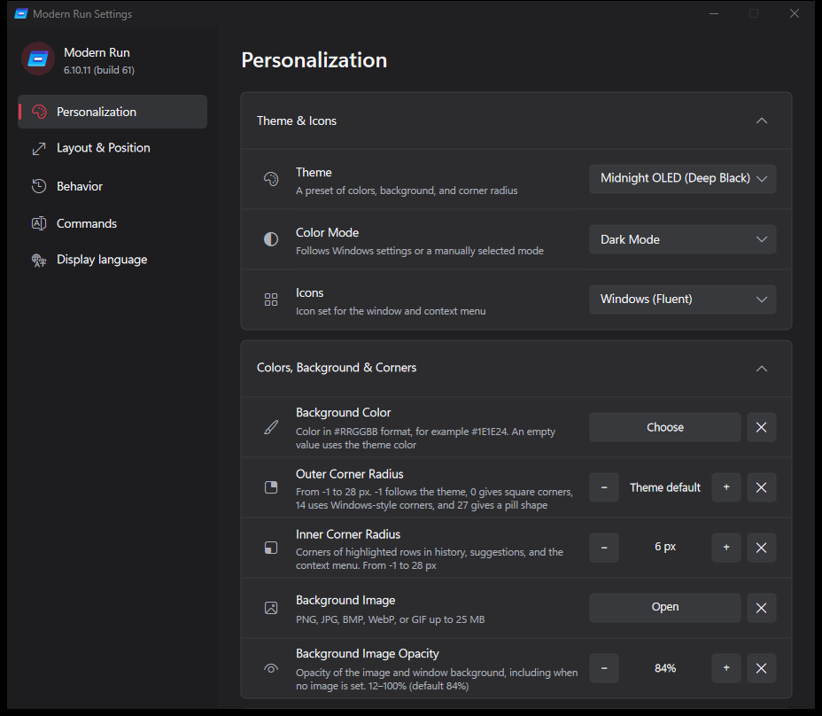

# Modern Run Dialog UI

[English](README.md) · **Tiếng Việt** · [Русский](README.ru.md) · [DSN Windhawk Mods (English)](../README.md)

Modern Run Dialog UI là bản mod Windhawk của caotu2005 dành cho Windows 10 và 11. Mod thay hộp thoại **Chạy** mở bằng **Win + R** và hộp thoại **Chạy tác vụ mới** trong Trình quản lý Tác vụ bằng cửa sổ có thể tùy chỉnh để mở ứng dụng, tệp và chạy lệnh.

## Tính năng

### Ba bố cục

Chọn **Classic**, **Compact Mini-Pill** hoặc **Fluent**. Classic là bố cục mặc định. Compact Mini-Pill dùng nút biểu tượng và thu gọn lịch sử khi mở. Nhấn **↑** để mở lịch sử. Fluent đặt các nút bên cạnh ô nhập, còn lịch sử và gợi ý xuất hiện phía trên. Bố cục, chủ đề, nút thao tác và lịch sử có thể được chỉnh riêng.

| Bố cục | Mở lịch sử | Đóng lịch sử | Máy tính, gợi ý hoặc quyền quản trị |
| --- | --- | --- | --- |
| **Classic** | [](Assets/Previews/classic-history.png)<br>Windows 11 Blur | [](Assets/Previews/classic-idle.png)<br>Warm Paper | [](Assets/Previews/classic-suggestions.png)<br>Dracula Velvet |
| **Compact Mini-Pill** | [](Assets/Previews/pill-history.png)<br>Nord Frost | [](Assets/Previews/pill-idle.png)<br>Classic Win11 | [](Assets/Previews/pill-suggestions.png)<br>Emerald Slate |
| **Fluent** | [](Assets/Previews/fluent-history.png)<br>Catppuccin Mocha | [](Assets/Previews/fluent-idle.png)<br>Windows 11 Mica | [](Assets/Previews/fluent-elevation.png)<br>Fluent Solid |

### Cài đặt



Trong cửa sổ Chạy, nhấn **Ctrl + ,** để mở cửa sổ cài đặt riêng. Vào mục **Lệnh** để chỉnh sửa các lệnh tùy chỉnh. Các tùy chọn chung cũng có trong thẻ **Cài đặt** của mod trong Windhawk. Thay đổi trong cửa sổ cài đặt của mod được lưu theo từng người dùng và áp dụng cho cửa sổ Chạy. Thẻ Windhawk hiển thị các giá trị riêng của nó. Khi sửa một tùy chọn chung trong Windhawk, giá trị mới sẽ thay thế giá trị đã đặt trong mod cho tùy chọn đó.

### Giao diện

- Chọn chủ đề như **Windows 11 Blur**, **Liquid Glass**, **Nord Frost** hoặc **Warm Paper**, rồi dùng bảng màu của Windows hoặc tự chọn chế độ sáng hay tối.
- Tùy chỉnh màu nền, độ mờ đục, bán kính bo góc ngoài và trong, cùng đường viền. Có thể dùng ảnh PNG, JPEG, BMP, WebP hoặc GIF động tối đa 25 MB làm nền.
- Điều chỉnh vị trí, chiều rộng, chiều cao, cỡ chữ và tỷ lệ giao diện. Có thể ghi nhớ vị trí giữa các lần mở.
- Ẩn riêng từng nút **Duyệt**, **Chạy**, **Đóng** và **Cài đặt** trong mọi bố cục. Các thao tác đã ẩn vẫn có trong menu chuột phải. Có thể chọn riêng kiểu menu và bộ biểu tượng.
- Chọn cách hoạt động của biểu tượng trên thanh tác vụ: thu nhỏ và khôi phục cửa sổ Chạy, đóng cửa sổ hoặc ẩn biểu tượng.

### Lệnh và lịch sử

- Tìm ứng dụng và công cụ Windows trong lúc nhập. Thêm lệnh tùy chỉnh với tên ngắn và chương trình, dòng lệnh hoặc tệp cần mở. Có thể đặt lệnh tùy chỉnh chạy với quyền quản trị.
- Lưu tối đa 50 lệnh gần đây. Có thể ghim, xóa từng mục và hiển thị ngày giờ theo định dạng khu vực của Windows. Đặt số mục lịch sử thành 0 để ẩn danh sách.
- Dùng **↑** và **↓** để duyệt lịch sử và gợi ý. Nhấn **Tab** để đưa mục đang chọn vào ô nhập hoặc **Enter** để chạy.
- Nhấn **Ctrl + O** để chọn tệp và **Esc** để đóng cửa sổ Chạy.
- Nhập biểu thức như `sqrt(144)` hoặc `2^10` để tính toán. Chọn kết quả để chèn vào ô nhập và sao chép vào bảng tạm. Dùng `google:<truy vấn>` để tìm trên web bằng trình duyệt mặc định.

### Chạy với quyền quản trị

Giữ **Ctrl + Shift** để xem trước quyền sẽ dùng rồi nhấn **Enter** để đổi quyền cho lần chạy này. Nếu đã bật quyền quản trị mặc định, tổ hợp đó sẽ chạy với quyền thông thường. Trạng thái có thể hiện trong bảng riêng hoặc qua biểu tượng khiên cạnh ô nhập. Mặc định, **Shift + Enter** chạy lệnh trong thiết bị đầu cuối và có thể được gán lại để đổi quyền. Nếu Trình quản lý Tác vụ yêu cầu chạy tác vụ với quyền quản trị, mod sẽ giữ yêu cầu đó.

## Nền tảng

Cần Windows 10 hoặc Windows 11 và [Windhawk](https://windhawk.net/). Cửa sổ Chạy sử dụng Direct2D và DirectWrite, hỗ trợ nhập trực tiếp qua bộ gõ Windows, gồm cả bộ gõ tiếng Việt, và có 21 ngôn ngữ giao diện. Kiểm soát Ứng dụng Thông minh (Smart App Control) của Windows có thể chặn mod vì Windhawk biên dịch mod trên máy thành tệp DLL không có chữ ký số. Mod không cần tệp ký hiệu PDB của shell32.

## Sử dụng và kiểm tra

### Cài đặt

#### Từ danh mục Windhawk (khuyên dùng)

Trong Windhawk, mở **Explore**, tìm **Modern Run Dialog UI** và chọn **Install**. [Trang mod trong danh mục Windhawk](https://windhawk.net/mods/modern-run-dialog-ui)

#### Từ mã nguồn (thủ công)

1. Mở [mã nguồn độc lập của mod](Mod/modern-run-dialog-ui.wh.cpp).
2. Nếu mod đã được cài, mở mod ở chế độ chỉnh sửa trong Windhawk. Nếu cài mới, chọn **Create a New Mod**.
3. Thay nội dung trình chỉnh sửa bằng toàn bộ mã nguồn, chọn **Compile Mod** và kiểm tra xem mod đã bật chưa.

### Sử dụng

Nhấn **Win + R** hoặc chọn **Chạy tác vụ mới** trong Trình quản lý Tác vụ. Nhấp chuột phải trong cửa sổ Chạy để mở menu thao tác. Nhấn **Ctrl + ,** để mở cài đặt mod.

### Kiểm tra

Dùng Node.js để chạy các bài kiểm tra bố cục, cài đặt và bản địa hóa từ thư mục gốc của kho mã.

```powershell
node --test Modern_Run_Dialog_UI/Tests/dialog-layout.test.mjs
```

## Giấy phép

Modern Run Dialog UI được phân phối theo [giấy phép MIT](LICENSE).
