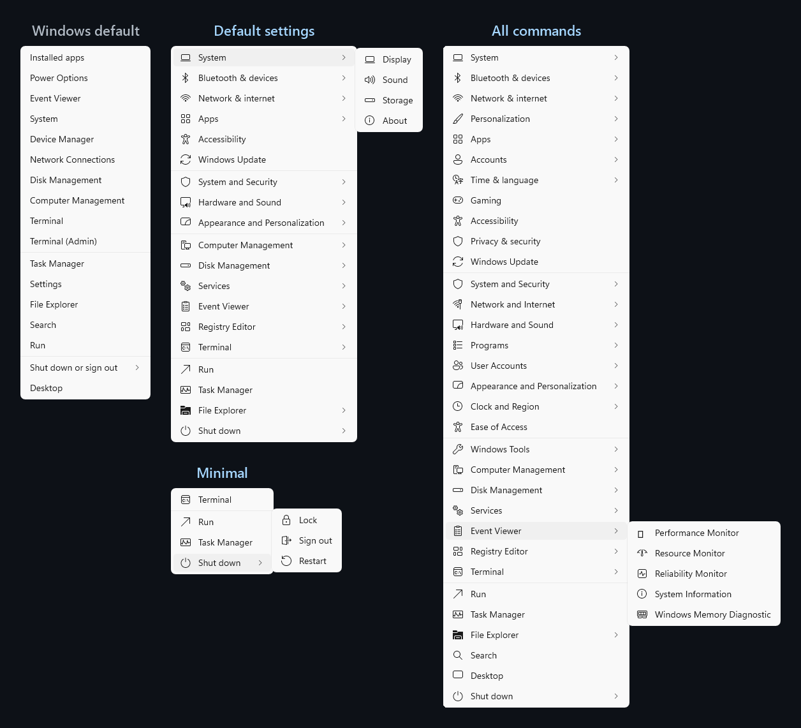

# Quick Link Menu

[English](README.md) · **Русский** · [DSN Windhawk Mods](../README.ru.md)

Quick Link Menu настраивает штатное меню Windows 11, которое открывается по
**Win+X** или правым кликом по кнопке «Пуск».

## Функции



### Настройка и доступность команд

- **Состав меню.** Можно скрыть отдельные строки, команды в подменю и целые
  разделы. При отключении раздела его настройки сохраняются. Выключенная строка
  скрывается вместе с подменю.
- **Автоматический отбор.** Мод скрывает недоступные команды с учетом редакции
  Windows, установленных компонентов, оборудования и системных политик. Если
  основное действие недоступно, его доступные подпункты остаются. Если список
  опустел, открывается штатное меню Win+X.
- **Права пользователя.** Дополнительный фильтр скрывает команды администратора,
  для которых в текущем сеансе нужны учетные данные или запрещено повышение прав.
  Команды, которым достаточно подтверждения UAC, остаются видимыми.
- **Раскрытие подменю.** По умолчанию подменю открывается сразу при наведении.
  Можно выбрать задержку, наведение на стрелку или нажатие на нее. Указатель
  в форме руки отмечает области запуска команд, эту индикацию можно отключить.
- **Запуск Терминала.** Основному пункту «Терминал» можно назначить запуск от
  имени администратора.

### Разделы меню

- **Параметры.** Переходы к разделам «Параметров» и отдельным страницам, таким
  как «Дисплей», «Звук», VPN, «Приложения по умолчанию» и «Центр обновления Windows».
- **Панель управления.** Классические категории и инструменты, например
  Диспетчер устройств, «Сетевые подключения», «Электропитание» и «Программы и компоненты».
- **Администрирование.** Управление компьютером, службы, просмотр событий,
  редактор реестра и Терминал. В подменю доступны планировщик заданий,
  оснастки сертификатов, Windows PowerShell и командная строка.
- **Основные команды.** «Выполнить», Диспетчер задач, поиск, Проводник, показ
  рабочего стола, питание и выход из системы. Проводник открывает выбранную
  в Windows стартовую страницу. В подменю доступны «Этот компьютер», «Загрузки»
  и «Корзина». Поиск, показ рабочего стола, а также «Документы» и «Изображения»
  в подменю Проводника выключены по умолчанию.

### Быстрый доступ к питанию

Основная строка питания по умолчанию завершает работу одним нажатием. Можно
назначить другое действие, например перезагрузку или блокировку, либо выбрать
**Нет**, чтобы нажатие только открывало подменю питания. Когда Windows добавляет
в Win+X завершение работы или перезагрузку с обновлением, этими пунктами управляют
те же переключатели, что и обычным завершением работы или перезагрузкой.

### Подписи и значки

Мод использует системные подписи на языке Windows и значки Segoe Fluent Icons.
Для переходов в «Параметры» используются значки соответствующих страниц,
если они есть в шрифте.

Настройки мода в Windhawk переведены на английский, русский, испанский,
немецкий, бразильский португальский и упрощенный китайский.

## Платформы

Нужны [Windhawk](https://windhawk.net/) и Windows 11 x64 или ARM64. Работу меню
проверили на Windows 11 24H2 Home и Pro x64 (сборка `26100.4349`) с Windhawk
1.7.3. Более раннюю версию также проверили на Windows 11 26H2 x64 (сборка
`26300.10075`). На ARM64 в GitHub Actions проверили нативную сборку и запустили
автоматические тесты доступности команд.

### Совместимость

Quick Link Menu работает со штатным Win+X Windows 11 и несовместим с модами,
которые его подменяют. Например, [Windows 10 Win+X restorer on Win11 24H2](https://github.com/ramensoftware/windhawk-mods/blob/main/mods/windows-10-winx-restorer.wh.cpp).

## Эксплуатация

### Установка

#### Из каталога Windhawk (рекомендуется)

В Windhawk откройте раздел **Обзор**, найдите **Quick Link Menu**, откройте его карточку и нажмите **Установить**.

[Страница мода в каталоге Windhawk](https://windhawk.net/mods/quick-link-menu)

#### Из исходника (вручную)

1. В Windhawk выбрать «Создать новую модификацию».
2. Заменить содержимое `mod.wh.cpp` полным [исходником мода](Mod/quick-link-menu.wh.cpp).
3. Нажать кнопку компиляции или `Ctrl+B` при открытой панели Windhawk. После
   компиляции выйти из редактора и убедиться, что **Quick Link Menu** включен
   на главной странице.

Для обновления открыть редактор установленного локального мода в Windhawk,
заменить исходник и повторить компиляцию.

[Режим редактирования Windhawk](https://github.com/ramensoftware/windhawk/wiki/Editing-mode-guidelines)

### Использование

В открытом меню нажать на название пункта или клавишу **Enter** для основного
действия. Подменю открывается нажатием на стрелку или клавишей **→**. Если
у пункта доступно только подменю, можно нажать на название.

Для изменения меню открыть **Quick Link Menu → Настройки** в Windhawk.
Переключатели разделов находятся под их описаниями. Переключатели строк и
подпунктов идут в порядке меню. Поведение подменю и фильтр прав находятся в
**Общих настройках**, запуск Терминала и действие питания — в **Настройках команд**.

### Проверка

Команды запускаются из корня репозитория. Нужен Node.js.

```powershell
node Quick_Link_Menu/Tools/package-mod.mjs --check
node --test Quick_Link_Menu/Tests/menu-settings.test.mjs
```

Первая команда сверяет готовый исходник с входными файлами. Тесты проверяют
настройки меню, значения по умолчанию и локализацию.
