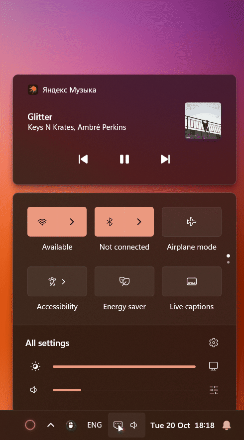

# Refined Quick Settings and Sound

[Русский](README.ru.md)

This "vanilla+" Windhawk mod reworks the Windows 11 "Quick Settings" and "Volume mixer" panels and makes them fit for daily use. It follows the Windows 11 design language, refining existing features and adding new ones: thin sliders, even row spacing at every display scale and a smooth frame transition to the Sound page.

Everything runs inside the shell's own panels (ShellHost): no extra windows, the system Acrylic, fonts, themes, lists, bindings and animations are kept, and customizations are restored when the mod is unloaded.

This edition is based on [HeyOkay's original mod](https://github.com/HeyOkay/Refined-Quick-Settings-and-Sound).

<picture>
  <source media="(prefers-color-scheme: dark)" srcset="Assets/Previews/Dark_Preview.webp">
  <source media="(prefers-color-scheme: light)" srcset="Assets/Previews/Light_Preview.webp">
  
</picture>

## Features

**Quick Settings**

- Settings opens Windows Settings. Choose up to five shortcuts to its right, including Notifications, Graphics, Advanced network settings, Power and Windows Update. Empty slots, repeats and shortcuts already visible in the brightness controls are skipped. Night light is available in the brightness row when it is shown.
- Night light uses the native quick action when available. If Windows cannot expose the action, the button opens the Night light settings page.
- **Display brightness** defaults to **Auto**. It keeps the Windows slider when available or adds one for a monitor with a usable DDC/CI range. **Disable** hides the brightness row.
- Set **Quick Settings tile rows** to 1–4. Pages follow the number of available tiles. The override is currently supported on Windows build 26300.9974.

**Sound**

- The "Sound output" page is now simply "Sound".
- Change the output and input devices and the spatial sound provider from dropdown lists.
- Below them, a reworked Volume mixer for the apps. It is collapsible and remembers its last state.
- Volume sliders show the new value when dragged or scrolled. The default wheel step is 2 percentage points.
- Press an app's icon to mute and restore it, or its volume number to set it to 100.
- Hide apps from the mixer by name or executable, one app per row.

**Taskbar**

- **Quick access to Sound** opens Sound with a click on the taskbar volume icon.
- **Middle-click to mute** toggles sound from the volume icon and preserves the volume level. Off by default.
- **More sound settings** in the volume icon menu opens the classic Sound Control Panel.
- **Device Manager** is available in the network and battery icon menus.
- **Alternative icons** provides a switch per location. Switching one off uses the Windows icon there.

When Windhawk adds the icon switches during a standard upgrade from 0.4.0, it starts them enabled. Apply any previous icon choices to the new switches.

Mod ID: `refined-quick-settings-and-sound`. The version is in `Mod/Source/sound-native.cpp`.

## Compatibility

Windows 11 24H2 or later with ShellHost Quick Settings, x86-64. The original mod was developed on build **26300**, primarily at **125%** display scale. Shell updates can change the XAML elements and symbols the mod uses. Added labels are available in English, Russian, Spanish, German, Brazilian Portuguese and Simplified Chinese. DDC/CI brightness requires DDC/CI to be enabled in the monitor's settings.

The mixer starts collapsed on the first Sound opening in each ShellHost process; subsequent openings remember its state. Disable other mods or styling rules that modify the same Quick Settings, Sound or taskbar volume elements.

Control Center discovery uses COM-interface symbol hooks in ControlCenter.dll and the public XAML visual tree; it does not open a XAML Diagnostics connection. Compatibility with other mods that edit the same controls still requires live testing. If the panel was already open when enabling the mod, close and reopen it; restart ShellHost if it is not picked up.

## Installation from source

1. Install [Windhawk](https://windhawk.net/).
2. Open [the standalone source](Mod/refined-quick-settings-and-sound.wh.cpp).
3. Disable the original Refined Quick Settings and Sound. Create a new mod in Windhawk, replace the template with the standalone source, then compile and enable it.
4. If the panels do not update, restart ShellHost. Windhawk logs contain diagnostic errors.

No prebuilt DLL is required. Open Quick Settings with Win+A and Sound with Win+Ctrl+V or the taskbar volume icon.

See the [preview recording guide](Preview.ru.md) to reproduce the demo.

## Building

Run from this mod directory with Python 3 on `PATH` and Windhawk installed. `Build-Mod.ps1` uses `C:/Program Files/Windhawk/Compiler` and Engine 1.7.3.

```powershell
.\Tools\Build-Mod.ps1
.\Tests\Test-Model.ps1
```

`Build-Mod.ps1` first runs `package_mod.py`, which assembles the standalone source in `Mod/` from `Mod/Source/`. The DLL goes to `Builds/Refined_Quick_Settings_and_Sound/` at the repository root. Use `Tools/Measure-PanelOpen.ps1` to measure panel opening time.

## Licenses

The mod is [GPL-3.0-only](LICENSE). The UI-thread dispatch technique follows m417z's Notification Center Styler (GPL-3.0); the hidden-apps parser is adapted from the Sound Output Direct and Taller mod. Lucide icons are ISC licensed, see [third-party notices](THIRD-PARTY-NOTICES.md) and `Mod/LUCIDE-LICENSE.txt`.
