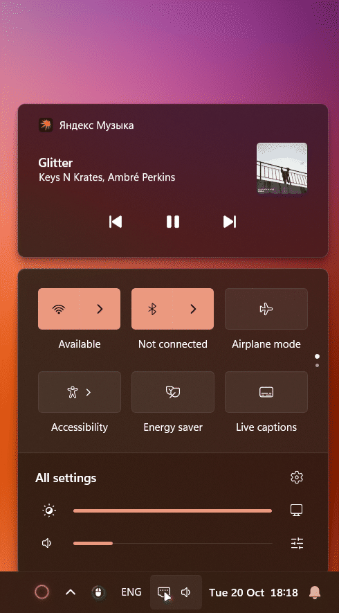

# Refined Quick Settings and Sound

[English](README.md)

Этот «vanilla+» мод для Windhawk перерабатывает панели «Быстрые настройки» и «Микшер громкости» Windows 11 и делает их пригодными для ежедневного использования. Он сохраняет стиль Windows 11, добавляя тонкие ползунки, равные отступы между строками и плавный переход к странице «Звук».

Мод работает внутри панелей оболочки (ShellHost). Системный акрил, шрифты, темы, списки, привязки и анимации сохраняются, а при выгрузке мода восстанавливается исходное оформление.

Эта версия основана на [оригинальном моде HeyOkay](https://github.com/HeyOkay/Refined-Quick-Settings-and-Sound).

<picture>
  <source media="(prefers-color-scheme: dark)" srcset="Assets/Previews/Dark_Preview.webp">
  <source media="(prefers-color-scheme: light)" srcset="Assets/Previews/Light_Preview.webp">
  
</picture>

## Функции

**Быстрые настройки**

- В разделе «Дополнительные переходы» можно выбрать до пяти кнопок справа от «Настроек», в том числе «Уведомления», «Графика», «Сетевые параметры», «Питание» и «Центр обновления». Пустые позиции и повторы пропускаются. Если в строке яркости уже есть кнопка параметров дисплея, она не дублируется.
- В строке яркости DDC/CI доступны параметры дисплея и «Ночной свет». Кнопка ночного света использует штатную плитку. Если плитка недоступна, открывается страница ночного света в параметрах Windows.
- «Яркость дисплея» по умолчанию работает в режиме «Авто». Используется штатный ползунок Windows, а при его отсутствии добавляется ползунок для мониторов с рабочим диапазоном DDC/CI. В режиме «Отключить» строка яркости скрывается.
- В настройке «Строки плиток» можно выбрать от одной до четырех строк. Число страниц зависит от количества плиток. Для изменения числа строк нужна версия ControlCenter из сборки Windows 26300.9974.

**Звук**

- Страница «Звуковой выход» теперь называется просто «Звук».
- Устройства вывода и ввода и поставщик пространственного звука выбираются из выпадающих списков.
- Ниже расположен переработанный микшер громкости приложений. При первом открытии панели «Звук» в каждом процессе ShellHost микшер свернут. При последующих открытиях он запоминает свое состояние.
- При перетаскивании ползунка и прокрутке колесиком появляется подсказка с новой громкостью. Шаг прокрутки по умолчанию — 2 процентных пункта.
- Нажатие на значок приложения отключает и возвращает его звук. Нажатие на число устанавливает громкость на 100 %.
- В разделе «Скрыть в микшере громкости» можно указать названия приложений или имена исполняемых файлов, по одному на строку. Звук скрытых приложений сохраняется.

**Панель задач**

- «Быстрый доступ к настройкам звука» открывает панель «Звук» по нажатию на значок громкости на панели задач.
- «Выключение звука средним кликом» сохраняет заданную громкость. По умолчанию выключено.
- «Дополнительные параметры звука» в меню значка открывают классическое окно «Звук» из панели управления.
- «Диспетчер устройств» доступен в меню значков сети и батареи.
- В разделе «Альтернативные иконки» доступны в том числе анимированный значок громкости и значок проводной сети из оригинального мода. У каждой позиции свой переключатель. Если его выключить, там появится иконка Windows.

## Платформы

Windows 11 24H2 и новее с быстрыми настройками в ShellHost, x86-64. Оригинальный мод разрабатывался на сборке **26300**, преимущественно при масштабе **125%**. Обновления Windows могут менять внутренние элементы XAML и символы оболочки, от которых зависит мод. Для регулировки яркости через DDC/CI нужен совместимый монитор с включенным DDC/CI.

Добавленные подписи доступны на английском, русском, испанском, немецком, португальском (Бразилия) и упрощенном китайском.

## Эксплуатация

### Установка

1. Установите [Windhawk](https://windhawk.net/) и откройте [единый файл исходника](Mod/refined-quick-settings-and-sound.wh.cpp).
2. Отключите оригинальный Refined Quick Settings and Sound и другие моды или правила оформления, меняющие те же элементы.
3. В Windhawk выберите «Создать новую модификацию» и замените содержимое `mod.wh.cpp` единым исходником. Нажмите «Скомпилировать модификацию», выйдите из редактора и проверьте, что мод включен.
4. Если панели не обновились, закройте и снова откройте их. При необходимости перезапустите ShellHost и проверьте журнал Windhawk.

### Использование

«Быстрые настройки» открываются через Win+A, «Звук» — через Win+Ctrl+V. Если включен «Быстрый доступ к настройкам звука», значок громкости на панели задач также открывает «Звук». Параметры мода доступны на вкладке «Настройки» в Windhawk.

### Сборка и проверка

Запускайте из каталога мода. Нужны Python 3 в `PATH` и установленный Windhawk. `Build-Mod.ps1` использует `C:/Program Files/Windhawk/Compiler` и Engine 1.7.3.

```powershell
.\Tools\Build-Mod.ps1
.\Tests\Test-Model.ps1
```

`Build-Mod.ps1` запускает `package_mod.py`, который собирает единый исходник в `Mod/` из файлов в `Mod/Source/`. DLL сохраняется в `Builds/Refined_Quick_Settings_and_Sound/` в корне репозитория. `Test-Model.ps1` проверяет логику модели. Для замера времени открытия панелей используется `Tools/Measure-PanelOpen.ps1`.

Запись анимации описана в [инструкции по записи превью](Preview.ru.md).

## Лицензии

Мод распространяется по [GPL-3.0-only](LICENSE). Подход к диспетчеризации в UI-поток основан на Notification Center Styler от m417z (GPL-3.0). Парсер скрытых приложений адаптирован из Sound Output Direct and Taller (GPL-3.0-only). Значки `sliders-horizontal` и `ethernet-port` взяты из [Lucide](Mod/LUCIDE-LICENSE.txt) (ISC). Подробности есть в [уведомлениях о стороннем коде](THIRD-PARTY-NOTICES.md).
