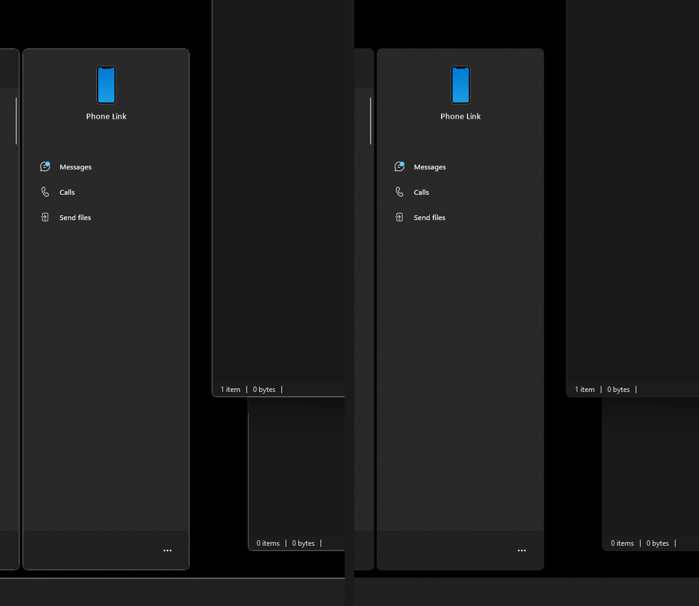
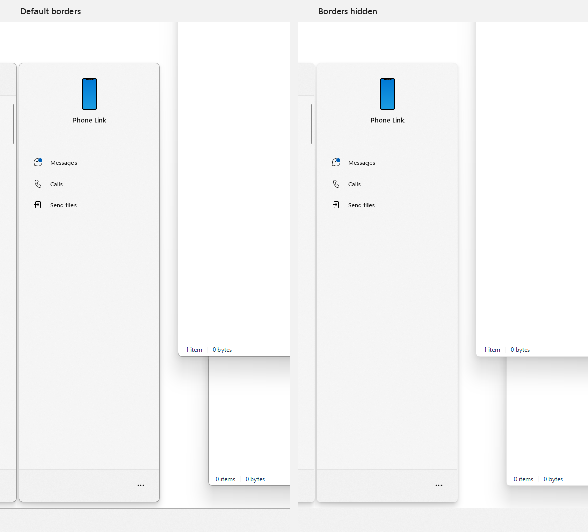

# Windows Border Switch

**English** · [Русский](README.ru.md) · [DSN Windhawk Mods](../README.md)

Windows Border Switch hides system-drawn borders around windows and panels in Windows 11.

## Features

|  |  |
| :---: | :---: |

| Setting | Controls |
| --- | --- |
| Active window | The focused window's system border or its title bar accent color |
| Inactive windows | System borders of windows without focus |
| Dialogs | System borders of classic Win32 dialogs, with or without focus |
| Taskbar | The taskbar edge and the virtual desktops strip at the bottom of Task View |
| Start menu | The Start menu and its Phone Link panel |
| Search | The Windows Search panel |
| Notifications | The notification center, calendar, and notification banners on the desktop |
| Quick Settings | Quick Settings and the media controls above them |
| Keyboard layout | The outer border of the keyboard layout selector |
| Widgets | The outer border of the Widgets board |
| Exceptions | Keep the usual border and title bar for active, inactive, or all windows of selected apps |

The interface is available in English, Russian, Spanish, German, Brazilian Portuguese, and Simplified Chinese.

### Limitations

- Shell borders depend on the Windows build and Windows Web Experience Pack. After enabling or updating the mod, some panels may require restarting Windows Explorer or signing out and back in.
- Apps running as administrator, including Windhawk, may retain their borders. Apps that draw their own frames control their appearance.

## Platforms

Requires Windows 11 x64 or ARM64 and [Windhawk](https://windhawk.net/).

### Compatibility

The following mods overlap with Windows Border Switch for application window borders:

- [Invisible Window Borders](https://windhawk.net/mods/invisible-borders) — also hides system-drawn window borders.
- [Windows 11 Accent Window Border](https://windhawk.net/mods/win11-accent-border) — sets window border colors, which can conflict with hiding those borders.

Do not use multiple mods to control the same window border or title bar: they can override each other's settings and exceptions. To use either mod for window borders and Windows Border Switch only for shell panels, set **Active window**, **Inactive windows**, and **Dialogs** to **Windows-defined** in Windows Border Switch.

The following Styler mods customize shell panels. Their themes and custom rules may also change borders:

- [Windows 11 Start Menu Styler](https://windhawk.net/mods/windows-11-start-menu-styler) — styles the Start menu and Search panel ([styling guide](https://github.com/ramensoftware/windows-11-start-menu-styling-guide)).
- [Windows 11 Taskbar Styler](https://windhawk.net/mods/windows-11-taskbar-styler) — styles the taskbar, including its edge ([styling guide](https://github.com/ramensoftware/windows-11-taskbar-styling-guide)).
- [Windows 11 Notification Center Styler](https://windhawk.net/mods/windows-11-notification-center-styler) — styles notifications, the calendar, Quick Settings, and media controls ([styling guide](https://github.com/ramensoftware/windows-11-notification-center-styling-guide)).

If a theme or rule controls the same border, set the corresponding Windows Border Switch option to **Windows-defined**, or remove the overlapping Styler rules.

## Operations

### Installation

#### Windhawk catalog (recommended)

In Windhawk, open **Explore**, search for **Windows Border Switch**, open its page, and select **Install**.

[Mod page in the Windhawk catalog](https://windhawk.net/mods/windows-border-switch)

#### From source (manual)

1. Open Windhawk and choose **Create a New Mod**.
2. Replace the contents of `mod.wh.cpp` with the complete [mod source](Mod/windows-border-switch.wh.cpp).
3. Select **Compile Mod**, exit the editor, and check that **Windows Border Switch** is enabled on the Windhawk home page.

To update a local installation, open its editor, replace the source, and compile it again.

[Windhawk editing mode guide](https://github.com/ramensoftware/windhawk/wiki/Editing-mode-guidelines)

### Usage

Open the mod's **Settings** in Windhawk. Each setting can be changed independently. Initially, the mod keeps the active window border, removes its title bar accent color, and hides the other listed borders. The title bar option applies when Windows uses the accent color for title bars.

Under **Exceptions**, add an executable name such as `steam.exe` and select which windows to exempt under **Do not hide border**.

Returning a window setting to **Windows-defined** restores the system DWM color. Applications that set a custom DWM color can reapply it when the window reopens.
