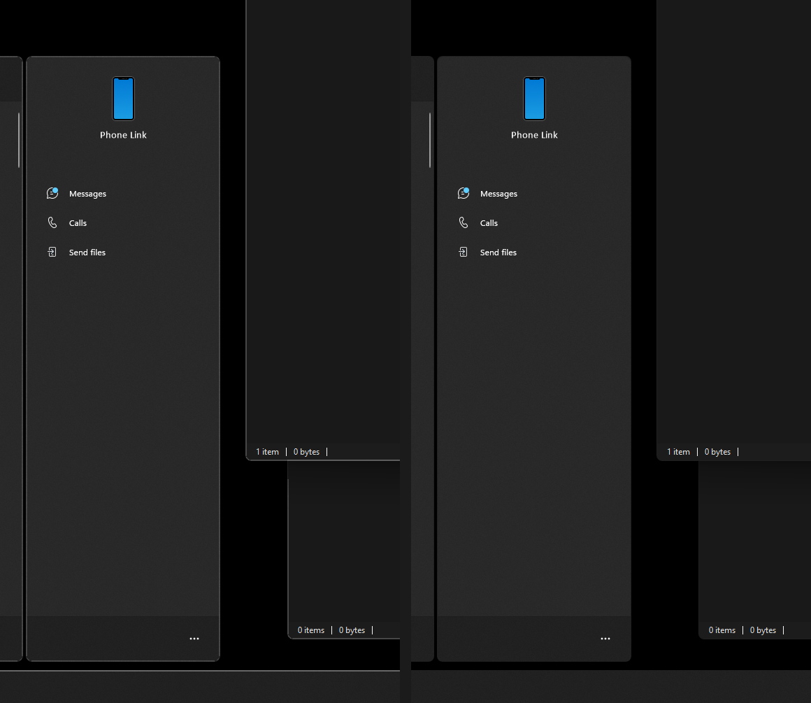
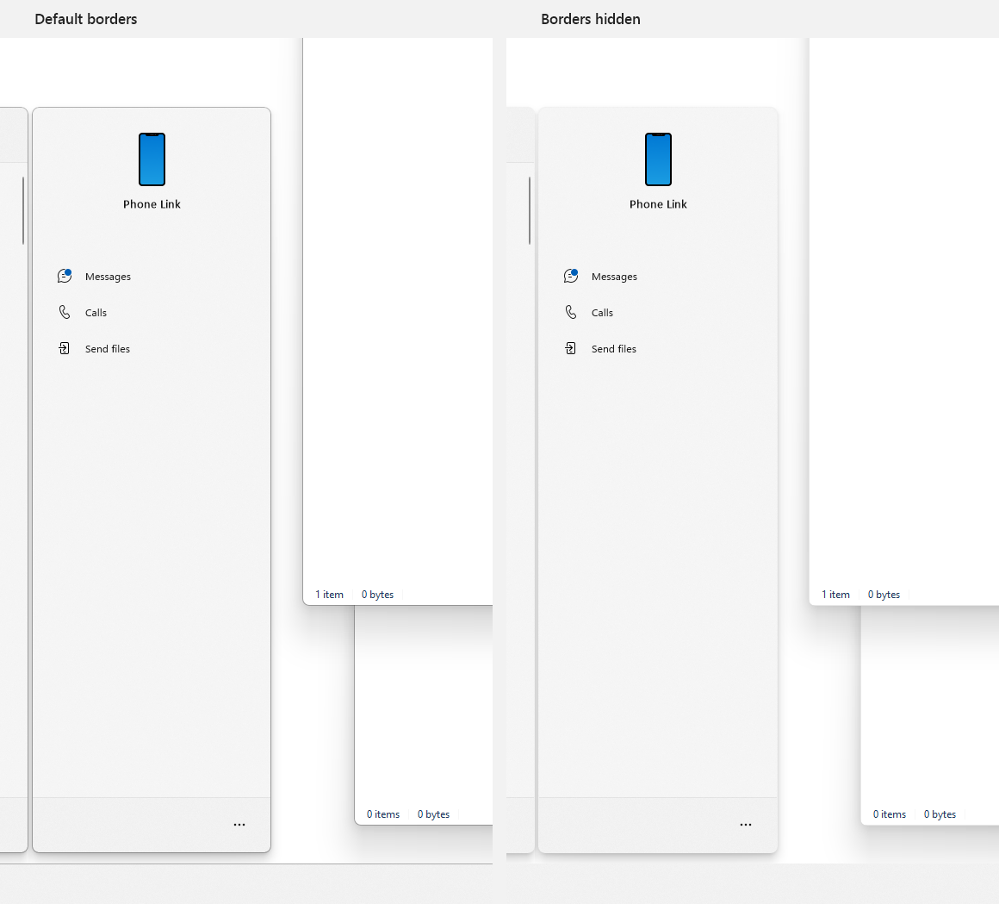

# Windows Border Switch

**English** · [Русский](README.ru.md) · [DSN Windhawk Mods](../README.md)

Windows Border Switch hides system-drawn borders around windows and panels in Windows 11.

## Features

|  |  |
| :---: | :---: |

| Setting | Controls |
| --- | --- |
| Active window border | The focused window's system border or its title bar accent color |
| Inactive window borders | System borders of windows without focus |
| Dialog borders | System borders of classic Win32 dialogs, with or without focus |
| Taskbar border | The taskbar edge and the virtual desktops strip at the bottom of Task View |
| Start menu border | The Start menu and its Phone Link panel |
| Search border | The Windows Search panel |
| Notification borders | The notification center, calendar, and notification banners on the desktop |
| Quick Settings border | Quick Settings and the media controls above them |
| Widgets board border | The outer border of the Widgets board |

The interface is available in English, Russian, Spanish, German, Brazilian Portuguese, and Simplified Chinese.

## Platforms

Requires Windows 11 x64 or ARM64 and [Windhawk](https://windhawk.net/).

### Limitations

- Shell borders depend on the Windows build and Windows Web Experience Pack. After enabling or updating the mod, some panels may require restarting Windows Explorer or signing out and back in.
- Windows running as administrator, including Windhawk when elevated, may retain their borders. Apps that draw their own frames control their appearance.
- Mods that change the same border or title bar can override each other, including Windows 11 Accent Window Border.

## Operations

### Installation

1. Open Windhawk and choose **Create a New Mod**.
2. Replace the contents of `mod.wh.cpp` with the complete [mod source](Mod/windows-border-switch.wh.cpp).
3. Select **Compile Mod**, exit the editor, and check that **Windows Border Switch** is enabled on the Windhawk home page.

To update a local installation, open its editor, replace the source, and compile it again.

[Windhawk editing mode guide](https://github.com/ramensoftware/windhawk/wiki/Editing-mode-guidelines)

### Usage

Open the mod's **Settings** in Windhawk. Each setting can be changed independently. Initially, the mod keeps the active window border, removes its title bar accent color, and hides the other listed borders. The title bar option applies when Windows uses the accent color for title bars.

Under **Exceptions**, add an executable name such as `steam.exe` and select active windows, inactive windows, or both.

Returning a window setting to **Windows-defined** restores the system DWM color. Applications that set a custom DWM color can reapply it when the window reopens.

## Links

- [Invisible Window Borders](https://github.com/ramensoftware/windhawk-mods/blob/main/mods/invisible-borders.wh.cpp)
- [Windows 11 Accent Window Border](https://github.com/ramensoftware/windhawk-mods/blob/main/mods/win11-accent-border.wh.cpp)
- [Windows 11 Start Menu Styler and its styling guide](https://github.com/ramensoftware/windows-11-start-menu-styling-guide)
- [Windows 11 Taskbar Styler and its styling guide](https://github.com/ramensoftware/windows-11-taskbar-styling-guide)
- [Windows 11 Notification Center Styler and its styling guide](https://github.com/ramensoftware/windows-11-notification-center-styling-guide)
