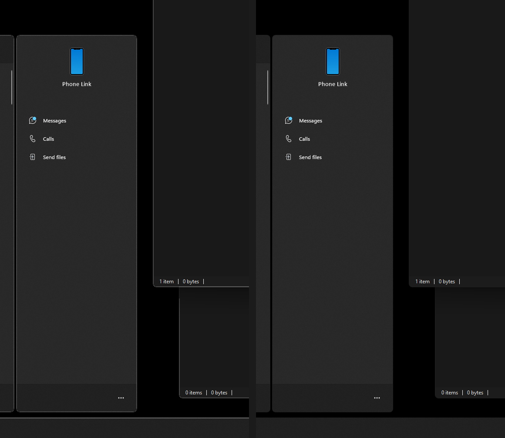
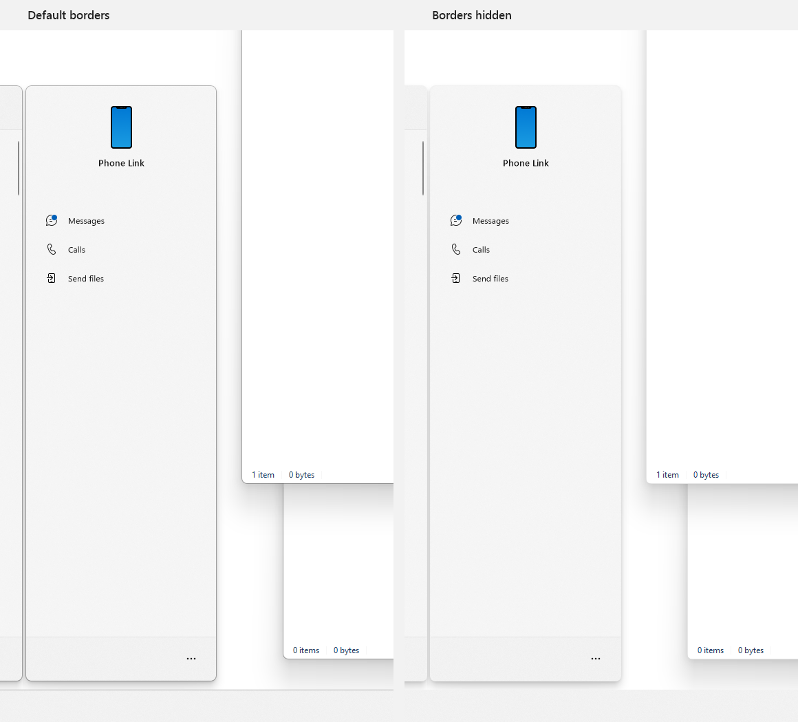

# Windows Border Switch

[English](README.md) · **Русский** · [DSN Windhawk Mods](../README.ru.md)

Windows Border Switch скрывает системные рамки окон и панелей в Windows 11.

## Функции

|  |  |
| :---: | :---: |

| Настройка | Что меняет |
| --- | --- |
| Активное окно | Системная рамка окна в фокусе или акцентный цвет его заголовка |
| Неактивные окна | Системные рамки окон вне фокуса |
| Диалоговые окна | Системные рамки классических диалогов Win32 независимо от фокуса |
| Панель задач | Кромка панели задач и нижняя панель рабочих столов в «Представлении задач» |
| Меню «Пуск» | Меню «Пуск» и его панель «Телефон» |
| Поиск | Панель поиска Windows |
| Уведомления | Центр уведомлений, календарь и баннеры уведомлений на рабочем столе |
| Быстрые настройки | Быстрые настройки и панель управления воспроизведением над ними |
| Мини-приложения | Внешняя рамка панели мини-приложений |
| Исключения | Сохранение обычной рамки и заголовка у активных, неактивных или всех окон выбранных приложений |

Интерфейс доступен на английском, русском, испанском, немецком, бразильском португальском и упрощенном китайском.

### Ограничения

- Поддержка рамок панелей зависит от сборки Windows и пакета Windows Web Experience Pack. После включения или обновления мода может потребоваться перезапуск Проводника либо выход из системы и повторный вход.
- Окна приложений, запущенных от имени администратора, могут сохранить рамки. Это относится и к окну Windhawk. Приложения, которые рисуют рамки сами, управляют их видом.
- Моды, меняющие ту же рамку или заголовок, могут перезаписывать изменения друг друга. Это касается и Windows 11 Accent Window Border.

## Платформы

Нужны Windows 11 x64 или ARM64 и [Windhawk](https://windhawk.net/).

## Эксплуатация

### Установка

1. В Windhawk выбрать «Создать новую модификацию».
2. Заменить содержимое `mod.wh.cpp` полным [исходником мода](Mod/windows-border-switch.wh.cpp).
3. Скомпилировать мод, выйти из редактора и убедиться, что **Windows Border Switch** включен на главной странице Windhawk.

Для обновления открыть редактор установленного локального мода, заменить исходник и повторить компиляцию.

[Режим редактирования Windhawk](https://github.com/ramensoftware/windhawk/wiki/Editing-mode-guidelines)

### Использование

Параметры меняются независимо на вкладке **Настройки** мода в Windhawk. Изначально мод сохраняет рамку активного окна, убирает акцентный цвет его заголовка и скрывает остальные перечисленные рамки. Параметр заголовка действует, когда Windows использует акцентный цвет для заголовков окон.

В разделе **Исключения** указывается имя исполняемого файла, например `steam.exe`, и в поле **Не скрывать рамку** выбираются окна, для которых действует исключение.

Режим **Определено Windows** восстанавливает системный цвет DWM. Приложения с собственным цветом DWM могут восстановить его при повторном открытии окна.

## Ссылки

- [Invisible Window Borders](https://github.com/ramensoftware/windhawk-mods/blob/main/mods/invisible-borders.wh.cpp)
- [Windows 11 Accent Window Border](https://github.com/ramensoftware/windhawk-mods/blob/main/mods/win11-accent-border.wh.cpp)
- [Windows 11 Start Menu Styler и руководство по настройке](https://github.com/ramensoftware/windows-11-start-menu-styling-guide)
- [Windows 11 Taskbar Styler и руководство по настройке](https://github.com/ramensoftware/windows-11-taskbar-styling-guide)
- [Windows 11 Notification Center Styler и руководство по настройке](https://github.com/ramensoftware/windows-11-notification-center-styling-guide)
